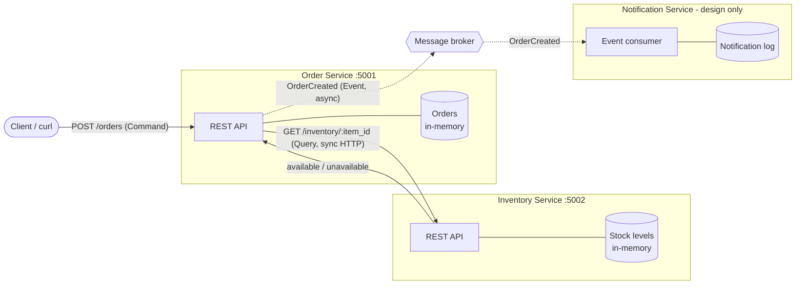

# Module 4: Architecture & Service Boundaries

A small online store split into independent services. Order Service and Inventory Service are implemented in Python (Flask) and run as separate processes. Notification Service is part of the design only.

## Setup and Running

Requires Python 3.9+.

```bash
git clone https://github.com/kmanoj03/mod4-lab.git
cd mod4-lab
python3 -m venv .venv
source .venv/bin/activate
pip install -r requirements.txt
```

Start each service in its own terminal (with the virtual environment activated):

```bash
# Terminal 1 - Inventory Service on http://127.0.0.1:5002
python inventory_service/app.py

# Terminal 2 - Order Service on http://127.0.0.1:5001
python order_service/app.py
```

Sample inventory: `apple` (10), `banana` (0), `laptop` (3), `headphones` (5).

| Endpoint | Description |
|---|---|
| `POST /orders` (Order) | Body: `{"item_id": "...", "quantity": N}`. Creates an order if the item is available. |
| `GET /orders/<order_id>` (Order) | Returns an existing order. |
| `GET /inventory/<item_id>?quantity=N` (Inventory) | Returns `available` or `unavailable`. |

## Architecture Diagram



Solid lines are synchronous HTTP calls (implemented). Dashed lines are asynchronous events through a message broker (design only).

## Components

| Service | Responsibility | Data it owns |
|---|---|---|
| **Order Service** | Accepts new orders, checks item availability with Inventory, creates and tracks orders, and publishes an `OrderCreated` event. | Orders: order ID, item ID, quantity, status. |
| **Inventory Service** | Tracks item availability and answers whether a requested quantity of an item is in stock. | Items and their stock levels. |
| **Notification Service** | Listens for `OrderCreated` events and notifies the user. | Notification records (who was notified, when, and the delivery status). |

Each service is the only one that reads or writes its own data. Other services get that data only through the owning service's API or events. For example, Order Service never reads stock levels directly; it asks Inventory Service.

## Why These Service Boundaries

- **Each service maps to one business capability.** Orders, stock, and notifications change for different reasons and can be owned and deployed separately.
- **Data has a single owner.** Stock levels live only in Inventory, so there is one source of truth and no shared database coupling the services.
- **Coupling matches the need.** Order *must* know availability before creating an order, so that call is synchronous. Notifying the user does not need to block order creation, so Notification is decoupled through an event. A slow or failed Notification Service cannot break ordering.
- **Failures are isolated.** If Inventory goes down, Order Service stays up and returns a clear error instead of crashing (see the failure test below).

## Command, Query, and Event

| Interaction | Type | Why |
|---|---|---|
| Check whether an item is available | **Query** | It asks Inventory Service for information and changes no state. Calling it twice gives the same answer. |
| Create an order | **Command** | It is a request to perform an action that changes state (a new order is stored). It is directed at one service, which can accept or reject it. |
| Order was created | **Event** | It announces a fact that already happened, named in the past tense. Order Service publishes it without knowing or waiting for who consumes it (e.g. Notification Service). |

## Example: Successful Request

With both services running:

```bash
$ curl -s -w "\nHTTP status: %{http_code}\n" -X POST http://127.0.0.1:5001/orders \
    -H "Content-Type: application/json" -d '{"item_id": "laptop", "quantity": 1}'
{"item_id":"laptop","order_id":"c3a753dc-88e4-46dc-979d-73d278dbdd0b","quantity":1,"status":"created"}
HTTP status: 201
```

When the item is out of stock, Inventory returns `unavailable` and the order is rejected:

```bash
$ curl -s -w "\nHTTP status: %{http_code}\n" -X POST http://127.0.0.1:5001/orders \
    -H "Content-Type: application/json" -d '{"item_id": "banana", "quantity": 1}'
{"item_id":"banana","quantity":1,"reason":"item is unavailable","status":"rejected"}
HTTP status: 409
```

## Failure Test: Inventory Service Stopped

The Inventory Service was stopped (Ctrl+C in Terminal 1) and another order was submitted:

```bash
$ curl -s -w "\nHTTP status: %{http_code}\n" -X POST http://127.0.0.1:5001/orders \
    -H "Content-Type: application/json" -d '{"item_id": "laptop", "quantity": 1}'
{"error":"Inventory Service is unavailable. Please try again later.","status":"failed"}
HTTP status: 503
```

The Order Service is still running afterwards:

```bash
$ curl -s -w "\nHTTP status: %{http_code}\n" http://127.0.0.1:5001/health
{"status":"ok"}
HTTP status: 200
```

Order Service terminal output during the test. The connection error is caught and logged, a `503` is returned, and the service keeps serving requests:

```
127.0.0.1 - - [18/Oct/2026 19:04:21] "POST /orders HTTP/1.1" 201 -
127.0.0.1 - - [18/Oct/2026 19:04:21] "POST /orders HTTP/1.1" 409 -
[2026-10-18 19:04:22,909] ERROR in app: Inventory Service unreachable: HTTPConnectionPool(host='127.0.0.1', port=5002): Max retries exceeded with url: /inventory/laptop?quantity=1 (Caused by NewConnectionError("HTTPConnection(host='127.0.0.1', port=5002): Failed to establish a new connection: [Errno 61] Connection refused"))
127.0.0.1 - - [18/Oct/2026 19:04:22] "POST /orders HTTP/1.1" 503 -
127.0.0.1 - - [18/Oct/2026 19:04:22] "GET /health HTTP/1.1" 200 -
```

## Reflection

Clear service boundaries let each service be built, deployed, and scaled independently, because each one has a single, well-defined job and a stable API. When each service owns its own data, there is exactly one source of truth (for example, only Inventory decides stock levels), which prevents conflicting updates and hidden coupling through a shared database. These boundaries also contain failures: in this project, stopping the Inventory Service did not crash the Order Service, which simply returned a clear `503` error. Without clear ownership, a change or outage in one part of the system can spread unpredictably to every other part.
