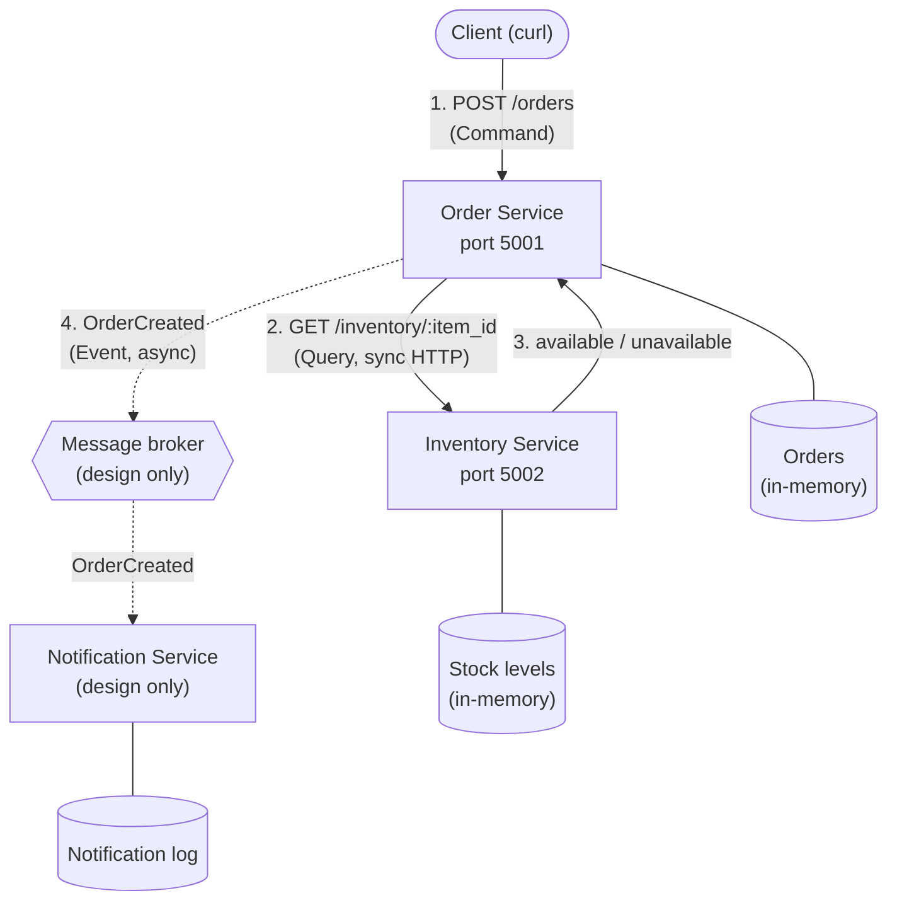

# Module 4: Architecture & Service Boundaries

A small online store split into independent services. Order Service and Inventory Service are implemented in Python (Flask) and run as two separate processes. Notification Service is part of the architecture design only (the assignment requires implementing only the Order → Inventory interaction).

```
mod4-lab/
├── order_service/app.py       # Order Service (port 5001)
├── inventory_service/app.py   # Inventory Service (port 5002)
└── requirements.txt
```

## Setup and Running

Requires Python 3.9+.

### Install dependencies

```bash
git clone https://github.com/kmanoj03/mod4-lab.git
cd mod4-lab
python3 -m venv .venv
source .venv/bin/activate
pip install -r requirements.txt
```

### Run the services

Start each service in its own terminal (activate the virtual environment in each one with `source .venv/bin/activate`):

```bash
# Terminal 1 - Inventory Service on http://127.0.0.1:5002
python inventory_service/app.py

# Terminal 2 - Order Service on http://127.0.0.1:5001
python order_service/app.py
```

### Send requests

From a third terminal:

```bash
curl -X POST http://127.0.0.1:5001/orders \
  -H "Content-Type: application/json" -d '{"item_id": "laptop", "quantity": 1}'
```

Sample inventory: `apple` (10), `banana` (0), `laptop` (3), `headphones` (5).

| Endpoint | Description |
|---|---|
| `POST /orders` (Order) | Body: `{"item_id": "...", "quantity": N}`. Creates an order if Inventory reports the item available. |
| `GET /orders/<order_id>` (Order) | Returns an existing order. |
| `GET /health` (Order and Inventory) | Returns `{"status": "ok"}` if the service is running. |
| `GET /inventory/<item_id>?quantity=N` (Inventory) | Returns `available` or `unavailable`. |

To run the failure test, stop the Inventory Service with `Ctrl+C` in Terminal 1 and submit another order.

## Architecture Diagram



Solid arrows are synchronous HTTP request/response calls (implemented). Dashed arrows are asynchronous events through a message broker (design only). Each service is connected only to its own data store.

**Flow:** (1) The client sends a create-order command to Order Service. (2) Order Service queries Inventory Service over HTTP. (3) Inventory replies `available` or `unavailable`, and Order Service creates or rejects the order. (4) In the full design, Order Service then publishes an `OrderCreated` event that Notification Service consumes.

## Component Responsibilities

- **Order Service:** The entry point for customers. It accepts order requests, asks Inventory Service whether the item is available, then creates the order (or rejects it) and keeps track of it. In the full design it also publishes an `OrderCreated` event after an order is created.
- **Inventory Service:** The authority on item availability. It tracks stock levels and answers whether a requested quantity of an item is available.
- **Notification Service (design only):** Listens for `OrderCreated` events and notifies the user that their order was placed. It never calls the other services directly.

## Data Ownership

| Service | Data it owns |
|---|---|
| **Order Service** | Orders: `order_id`, `item_id`, `quantity`, `status`. |
| **Inventory Service** | Items and their stock levels (`item_id` → quantity in stock). |
| **Notification Service** | Notification records: which user was notified, for which order, when, and the delivery status. |

Each service is the only one allowed to read or write its own data, and there is no shared database. Other services access that data only through the owning service's API or through events. For example, Order Service stores an `item_id` on each order as a reference, but it never stores or reads stock levels itself; it always asks Inventory Service.

## Service Boundaries

- **Each service maps to one business capability.** Taking orders, managing stock, and notifying users change for different reasons and can be developed, deployed, and scaled separately.
- **Each piece of data has a single owner.** Stock levels live only in Inventory, so there is one source of truth and no shared database coupling the services together.
- **Communication style matches the need.** Order Service *must* know availability before it can accept an order, so that call is synchronous (request/response). Notifying the user does not need to block order creation, so Notification is decoupled through an asynchronous event, and a slow or failed Notification Service cannot break ordering.
- **Failures stay isolated.** If Inventory goes down, Order Service stays up and returns a clear error instead of crashing (see the failure test below).

## Command, Query, and Event

| Interaction | Type | Why |
|---|---|---|
| Check whether an item is available | **Query** | It only asks Inventory Service for information and does not change any state. Order Service needs the answer before continuing. |
| Create an order | **Command** | It is a request for Order Service to perform an action that changes state (a new order is stored). It is sent to one specific service, which can accept or reject it. |
| Order was created | **Event** | It announces a fact that has already happened (named in the past tense). Order Service publishes it without knowing or waiting for who consumes it (e.g. Notification Service). |

## Implementation Output

All output below is from running the services locally as described in [Setup and Running](#setup-and-running).

### Both services run as independent processes

Terminal 1 (Inventory Service):

```
$ python inventory_service/app.py
 * Serving Flask app 'app'
 * Debug mode: off
WARNING: This is a development server. Do not use it in a production deployment. Use a production WSGI server instead.
 * Running on http://127.0.0.1:5002
Press CTRL+C to quit
```

Terminal 2 (Order Service):

```
$ python order_service/app.py
 * Serving Flask app 'app'
 * Debug mode: off
WARNING: This is a development server. Do not use it in a production deployment. Use a production WSGI server instead.
 * Running on http://127.0.0.1:5001
Press CTRL+C to quit
```

### Inventory Service returns available or unavailable

```bash
$ curl -s -w "HTTP status: %{http_code}\n" "http://127.0.0.1:5002/inventory/laptop?quantity=1"
{"in_stock":3,"item_id":"laptop","requested":1,"status":"available"}
HTTP status: 200

$ curl -s -w "HTTP status: %{http_code}\n" "http://127.0.0.1:5002/inventory/banana?quantity=1"
{"in_stock":0,"item_id":"banana","requested":1,"status":"unavailable"}
HTTP status: 200
```

## Example: Successful Request

With both services running, an order for an available item is created:

```bash
$ curl -s -w "HTTP status: %{http_code}\n" -X POST http://127.0.0.1:5001/orders \
    -H "Content-Type: application/json" -d '{"item_id": "laptop", "quantity": 1}'
{"item_id":"laptop","order_id":"00326f61-b061-4b0a-9088-f2eb9a8c98d1","quantity":1,"status":"created"}
HTTP status: 201
```

The Inventory Service terminal shows the availability query it received from Order Service while handling this order:

```
127.0.0.1 - - [18/Oct/2026 19:10:10] "GET /inventory/laptop?quantity=1 HTTP/1.1" 200 -
```

The order is stored and tracked by Order Service:

```bash
$ curl -s -w "HTTP status: %{http_code}\n" http://127.0.0.1:5001/orders/00326f61-b061-4b0a-9088-f2eb9a8c98d1
{"item_id":"laptop","order_id":"00326f61-b061-4b0a-9088-f2eb9a8c98d1","quantity":1,"status":"created"}
HTTP status: 200
```

## Example: Item Unavailable

Inventory returns `unavailable` for `banana`, so Order Service rejects the order:

```bash
$ curl -s -w "HTTP status: %{http_code}\n" -X POST http://127.0.0.1:5001/orders \
    -H "Content-Type: application/json" -d '{"item_id": "banana", "quantity": 1}'
{"item_id":"banana","quantity":1,"reason":"item is unavailable","status":"rejected"}
HTTP status: 409
```

## Failure Test: Inventory Service Stopped

The Inventory Service was stopped (`Ctrl+C` in Terminal 1) and another order was submitted. Order Service handled the failed connection and returned `503 Service Unavailable` with an error message:

```bash
$ curl -s -w "HTTP status: %{http_code}\n" -X POST http://127.0.0.1:5001/orders \
    -H "Content-Type: application/json" -d '{"item_id": "laptop", "quantity": 1}'
{"error":"Inventory Service is unavailable. Please try again later.","status":"failed"}
HTTP status: 503
```

Order Service did not crash and is still running:

```bash
$ curl -s -w "HTTP status: %{http_code}\n" http://127.0.0.1:5001/health
{"status":"ok"}
HTTP status: 200
```

After the Inventory Service was started again, the same order succeeded without restarting Order Service:

```bash
$ curl -s -w "HTTP status: %{http_code}\n" -X POST http://127.0.0.1:5001/orders \
    -H "Content-Type: application/json" -d '{"item_id": "laptop", "quantity": 1}'
{"item_id":"laptop","order_id":"b8cd4e55-1027-4d17-b5de-2947de151546","quantity":1,"status":"created"}
HTTP status: 201
```

Order Service terminal output for the whole run. The connection error is caught and logged, a `503` is returned, and the service keeps serving requests:

```
127.0.0.1 - - [18/Oct/2026 19:10:10] "POST /orders HTTP/1.1" 201 -
127.0.0.1 - - [18/Oct/2026 19:10:10] "GET /orders/00326f61-b061-4b0a-9088-f2eb9a8c98d1 HTTP/1.1" 200 -
127.0.0.1 - - [18/Oct/2026 19:10:10] "POST /orders HTTP/1.1" 409 -
[2026-10-18 19:10:11,331] ERROR in app: Inventory Service unreachable: HTTPConnectionPool(host='127.0.0.1', port=5002): Max retries exceeded with url: /inventory/laptop?quantity=1 (Caused by NewConnectionError("HTTPConnection(host='127.0.0.1', port=5002): Failed to establish a new connection: [Errno 61] Connection refused"))
127.0.0.1 - - [18/Oct/2026 19:10:11] "POST /orders HTTP/1.1" 503 -
127.0.0.1 - - [18/Oct/2026 19:10:11] "GET /health HTTP/1.1" 200 -
127.0.0.1 - - [18/Oct/2026 19:10:13] "POST /orders HTTP/1.1" 201 -
```

## Reflection

Clear service boundaries let each service be built, deployed, and scaled independently, because each one has a single, well-defined job and a stable API. When each service owns its own data, there is exactly one source of truth (for example, only Inventory decides stock levels), which prevents conflicting updates and hidden coupling through a shared database. These boundaries also contain failures: in this project, stopping the Inventory Service did not crash the Order Service, which simply returned a clear `503` error. Without clear ownership, a change or outage in one part of the system can spread unpredictably to every other part.
